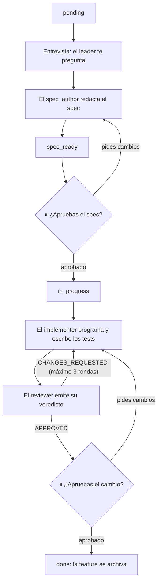

# Harness Engineering para Claude Code

Plantilla para que agentes de IA desarrollen software de forma **autónoma y
verificable** con [Claude Code](https://github.com/anthropics/claude-code).
Organiza el repositorio en torno a cinco ideas:

- **Cuatro agentes con papeles separados**: uno orquesta, otro especifica,
  otro programa y otro revisa.
- **Especificación antes que código**, con dos aprobaciones humanas
  obligatorias.
- **Memoria dentro del repositorio**, para que nada dependa de lo que
  recuerde el modelo.
- **Verificación automática**: un script y unos hooks bloquean lo que no se
  puede saltar.
- **Un grafo de contexto**, para que los agentes encuentren el código sin
  leerlo entero.

Incluye un proyecto de ejemplo, un CLI de notas en Python, que sirve solo
como guía: enseña cómo queda cada archivo cuando está relleno.

> Lo importante de este repositorio no es **qué** hace la aplicación, sino
> **cómo** está organizado para que un agente trabaje en él sin perderse ni
> saltarse pasos.

## Índice

1. [Qué es y qué problema resuelve](#qué-es-y-qué-problema-resuelve)
2. [Requisitos](#requisitos)
3. [Inicio rápido](#inicio-rápido)
4. [Cómo arranca una sesión](#cómo-arranca-una-sesión)
5. [Los agentes](#los-agentes)
6. [El ciclo de vida de una feature](#el-ciclo-de-vida-de-una-feature)
7. [La memoria del proyecto](#la-memoria-del-proyecto)
8. [Las convenciones del proyecto](#las-convenciones-del-proyecto)
9. [El árbitro: init.sh](#el-árbitro-initsh)
10. [Los hooks y los permisos](#los-hooks-y-los-permisos)
11. [El grafo de contexto](#el-grafo-de-contexto)
12. [El proyecto de ejemplo](#el-proyecto-de-ejemplo)
13. [Empezar tu propio proyecto](#empezar-tu-propio-proyecto)
14. [Estructura del repositorio](#estructura-del-repositorio)
15. [Principios de diseño](#principios-de-diseño)
16. [Créditos y licencia](#créditos-y-licencia)

## Qué es y qué problema resuelve

Un agente de IA que trabaja solo en un proyecto tiene cuatro problemas:

- **Olvida.** Cada sesión, cada subagente y cada compactación del contexto
  empiezan de cero.
- **Supone.** Si una regla no está escrita, la inventa con lo que tenga a
  mano.
- **Se aprueba a sí mismo.** Dice «funciona» sin demostrarlo.
- **Lee de más.** Recorre archivos enteros para orientarse y gasta el
  contexto, que es lo que más le escasea.

La respuesta de este arnés es una sola idea: **el repositorio es el
sistema**. Todo lo importante vive en archivos versionados, y un script y
unos hooks comprueban que se cumple. El sistema tiene seis piezas:

| Pieza | Dónde está | Para qué sirve |
|---|---|---|
| Instrucciones | [`CLAUDE.md`](CLAUDE.md) → [`AGENTS.md`](AGENTS.md) y [`.claude/agents/`](.claude/agents/) | Las reglas comunes y el protocolo de cada agente |
| Agentes | `leader`, `spec_author`, `implementer` y `reviewer` | Repartir el trabajo y que nadie revise lo suyo |
| Memoria | [`feature_list.json`](feature_list.json), [`progress/`](progress/), `specs/`, [`docs/lessons.md`](docs/lessons.md) y [`docs/brief.md`](docs/brief.md) | Que nada dependa de que alguien recuerde |
| Convenciones | [`docs/architecture.md`](docs/architecture.md), [`docs/conventions.md`](docs/conventions.md), [`docs/verification.md`](docs/verification.md) y [`CHECKPOINTS.md`](CHECKPOINTS.md) | Dejar escrito qué es un buen trabajo |
| Verificación | [`init.sh`](init.sh) y los hooks de [`.claude/settings.json`](.claude/settings.json) | Que saltarse una regla produzca un fallo |
| Contexto | `graphify-out/`, que se genera en local | Encontrar el código sin leerlo entero |

Vocabulario mínimo para leer el resto:

- **Claude Code**: el asistente de programación de Anthropic que se usa desde
  la terminal. Aquí ejecuta a todos los agentes.
- **Subagente**: un agente que la sesión principal lanza para una tarea
  concreta. Empieza con el contexto vacío y, al terminar, devuelve un
  resultado.
- **Feature**: una unidad de trabajo de la cola `feature_list.json`: un
  comando nuevo, una pantalla, un cambio de texto…
- **Spec**: la especificación de una feature: qué debe hacer, cómo se va a
  construir y en qué pasos.
- **SDD (Spec Driven Development)**: primero se escribe y se aprueba el
  spec, y después se programa.
- **Hook**: un comando que Claude Code ejecuta por su cuenta cuando pasa algo
  (antes de editar un archivo, al terminar un turno…) y que puede bloquear la
  acción.

## Requisitos

| Herramienta | ¿Hace falta? | Para qué |
|---|---|---|
| [Claude Code](https://github.com/anthropics/claude-code) | Sí | Ejecuta a los agentes |
| Python 3.9 o superior | Sí | Lo usan `init.sh` y los hooks, aunque tu proyecto sea de otro lenguaje |
| git | Recomendado | El reviewer revisa los cambios con `git diff`, y sin git no se puede deshacer la retirada del ejemplo |
| [graphify](https://github.com/Graphify-Labs/graphify) | Recomendado | El grafo de contexto. Se instala con `uv tool install graphifyy` (o `pip install graphifyy`) |
| `playwright-cli` o `chrome-devtools` | Solo si tu proyecto tiene interfaz web | Que el reviewer pruebe la interfaz (ver [`docs/ui-review.md`](docs/ui-review.md) y sus skills en `.claude/skills/`) |

Sin graphify todo funciona igual: `init.sh` muestra un aviso y los agentes
tienen que leer más código para orientarse.

## Inicio rápido

```bash
git clone https://github.com/<usuario>/<repositorio>.git
cd <repositorio>
./init.sh   # tiene que terminar con «[OK] Entorno listo»
claude      # abre Claude Code; la sesión arranca como el agente leader
```

En un clon recién descargado, `./init.sh` termina con algo así:

```
── 6. Estado del trabajo ───────────────────────────────
  Features del proyecto: ninguna
  Ejemplos:              incluidos solo como guía (carpetas example/)
  Siguiente id libre:    #12
  Fuera de las features: 0 decisión(es) pendiente(s) del usuario, 0 deuda(s) (progress/pending.md)
  Git:                   rama main, 0 archivo(s) con cambios sin commitear

── 7. Resumen ──────────────────────────────────────────
[OK]    Entorno listo. Puedes empezar a trabajar.
```

Después, en el chat de Claude Code:

1. **Cuéntale al leader qué quieres construir**, por ejemplo «quiero que los
   usuarios puedan registrarse con email y contraseña». Lo añade como
   feature a la cola.
2. **Pídele «implementa la siguiente feature pendiente».** La primera vez
   prepara contigo el proyecto (ver
   [Empezar tu propio proyecto](#empezar-tu-propio-proyecto)). Después te
   entrevista sobre la feature, encarga el spec y **para** para que lo
   revises.
3. **Lee el spec** en `specs/<feature>/` y responde «aprobado» o pide
   cambios.
4. **Espera a la revisión.** El leader lanza al implementer y al reviewer, y
   vuelve a **parar** con un resumen del cambio. Responde «aprobado» para
   cerrar la feature, o pide cambios.

Mientras tanto, ten abiertas `specs/` y `progress/` en tu editor: cada
informe aparece en cuanto el subagente termina.

## Cómo arranca una sesión

1. **La sesión principal es el leader.** `.claude/settings.json` contiene
   `"agent": "leader"`. No hablas con un Claude genérico, sino con un
   orquestador que no puede tocar el código.
2. **Se cargan las reglas comunes.** `CLAUDE.md` importa `AGENTS.md`: el mapa
   del repositorio y las reglas que valen para todos. Esto ocurre también en
   cada subagente.
3. **El leader recibe el estado real.** El hook H5 ejecuta
   `./init.sh --status` y le pasa el resultado: las features de tu proyecto,
   lo que espera tu aprobación, la siguiente pendiente y el siguiente id
   libre.
4. **El leader comprueba el entorno.** Con tu primera petición lee
   `feature_list.json`, `progress/current.md` y `progress/pending.md`, y
   ejecuta `./init.sh` completo. Si falla, para y te lo dice.

> **La regla que atraviesa todo el sistema:** si `init.sh` contradice lo
> escrito en `progress/`, manda `init.sh`. Lo escrito a mano se queda
> desfasado; lo que se calcula a partir de los archivos, no.

## Los agentes

Cada agente tiene su definición en [`.claude/agents/`](.claude/agents/):

| Agente | Qué hace | Qué puede escribir | Qué devuelve |
|---|---|---|---|
| **leader** (sesión principal) | Te entrevista, lanza a los demás, cambia el estado de las features, para en las puertas de aprobación y cierra | `feature_list.json`, `feature_archive.json`, `progress/` y `docs/`. Nunca `src/` ni `tests/` | Mensajes para ti |
| **spec_author** | Convierte la feature y tu entrevista en un spec | `specs/<feature>/` | `spec_ready -> specs/<feature>/` |
| **implementer** | Ejecuta las tasks del spec, con sus tests | `src/`, `tests/`, las casillas de `tasks.md`, `progress/current.md` y `progress/impl_<feature>.md` | `done -> progress/impl_<feature>.md` |
| **reviewer** | Aprueba o rechaza el cambio contra el spec, los docs y los checkpoints | Solo `progress/review_<feature>.md` | `APPROVED`, `CHANGES_REQUESTED` o `SCREENSHOT_REQUESTED`, con la ruta del informe |

Nadie hace dos papeles: el leader no programa, el spec_author no escribe
código, el implementer no se aprueba a sí mismo y el reviewer no corrige. Por
encima de todos, **solo tú apruebas** un spec o un cambio, y solo tú decides
que algo es trivial. En features complejas, el leader puede lanzar antes dos
o tres subagentes `Explore` para investigar el código.

### Cómo se coordinan

- **Cada subagente empieza sin contexto.** No hereda la conversación: el
  leader le copia en el prompt la entrada de la feature (`id`, `name`,
  `description`, `acceptance`…), sus rutas y lo que necesita su papel. Así
  cada uno trabaja con un contexto pequeño y limpio.
- **Divulgación progresiva.** Cada definición dice qué leer y cuándo, y nadie
  lee por adelantado. Los procedimientos que se usan una sola vez
  ([`docs/project-setup.md`](docs/project-setup.md) y
  [`docs/ui-review.md`](docs/ui-review.md)) solo se abren cuando hacen falta.
- **Regla anti-teléfono-descompuesto.** Los resultados se escriben en disco y
  por el chat solo viaja una línea con la ruta. La información no se degrada
  al pasar de un agente a otro, queda versionada y sobrevive a una
  interrupción.

### Qué lee cada uno

| Agente | Qué lee |
|---|---|
| spec_author | `brief.md` y `architecture.md` enteros; de `conventions.md`, los nombres, los tests y los errores; de `verification.md`, los niveles de verificación; el índice y los callejones sin salida de `lessons.md`; las reglas de [`docs/specs.md`](docs/specs.md); y las decisiones de tu entrevista |
| implementer | `architecture.md`, `conventions.md` y `verification.md` enteros; el índice y los callejones sin salida de `lessons.md`; y el spec completo |
| reviewer | Lo mismo que el implementer, más las reglas del spec de `docs/specs.md`, `CHECKPOINTS.md`, su guía de revisión, el informe del implementer y el código cambiado |

### Dónde deja su rastro cada uno

| Archivo | Quién lo escribe | Qué contiene |
|---|---|---|
| `specs/<feature>/requirements.md` | spec_author | Requisitos numerados `R1`, `R2`… en notación EARS |
| `specs/<feature>/design.md` | spec_author | Decisiones técnicas, contratos de datos y una alternativa descartada |
| `specs/<feature>/tasks.md` | spec_author | Checklist que el implementer va marcando `[x]` |
| `progress/current.md` | leader e implementer | Plan vivo de la feature en curso y decisiones de la entrevista |
| `progress/impl_<feature>.md` | implementer | Archivos tocados, mapa `R<n> → test`, resultado de los tests y lecciones |
| `progress/review_<feature>.md` | reviewer | Veredicto, trazabilidad, checkpoints y hallazgos |
| `feature_list.json` | leader | La cola de features sin cerrar |
| `feature_archive.json` | leader | Las features cerradas |
| `progress/history.md` | leader | Un resumen por cada feature cerrada |

## El ciclo de vida de una feature

Toda feature con `"sdd": true` sigue este flujo. El leader lo conduce y se
detiene en las dos puertas (⏸), donde decides tú:



| Estado | Qué significa |
|---|---|
| `pending` | Sin spec. Toca la entrevista y después el spec. |
| `spec_ready` | El spec está redactado y espera tu aprobación. No se toca código. |
| `in_progress` | Spec aprobado: se implementa y se revisa, o el cambio espera tu aprobación final. |
| `done` | Revisada y aprobada por ti. Pasa de `feature_list.json` a `feature_archive.json`. |
| `blocked` | Atascada. El motivo está en `progress/current.md`. |

Solo puede haber una feature `in_progress` a la vez.

### 1. Entrevista

Antes del spec, el leader te hace preguntas por rondas, con la técnica de la
skill [`grilling`](.claude/skills/grilling/SKILL.md):

- Numera las preguntas `P1`, `P2`… y da su recomendación en cada una.
- Lo que se puede averiguar (qué hay en el código, qué usa qué) lo busca él
  con el grafo. A ti solo te pregunta lo que tienes que decidir.
- Si una respuesta choca con lo que el proyecto no debe hacer
  (`docs/brief.md`) o con una lección aprendida, te avisa.
- Al terminar te pide que confirmes el resumen y lo guarda en
  `progress/current.md`, en la sección «Decisiones de la entrevista»:
  objetivo, decisiones, qué queda fuera y qué queda sin decidir.

Si la feature ya está bien definida, la entrevista se reduce a un resumen que
confirmas. Solo tú puedes saltártela.

### 2. Spec

El spec_author escribe tres archivos en `specs/<feature>/`:

- **`requirements.md`**: qué debe hacer la feature, en requisitos `R1`,
  `R2`… escritos en notación **EARS**. Un solo `DEBE` por requisito, sin
  verbos blandos («podría», «soporta»), y cada uno comprobable con un test.
- **`design.md`**: cómo se va a construir: archivos, firmas, errores, los
  **contratos de datos** con nombres y tipos exactos, y al menos una
  alternativa descartada. Todo lo que propone cita el requisito que lo
  justifica; lo que no tiene requisito se quita (regla anti-sobreingeniería).
- **`tasks.md`**: una checklist `T1`, `T2`…, y cada task dice qué requisitos
  cubre.

Los seis patrones de EARS:

| Patrón | Plantilla |
|---|---|
| Ubicuo | `El sistema DEBE <acción>.` |
| Evento | `CUANDO <disparador>, el sistema DEBE <acción>.` |
| Estado | `MIENTRAS <estado>, el sistema DEBE <acción>.` |
| Opcional | `DONDE <feature opcional>, el sistema DEBE <acción>.` |
| No deseado | `SI <evento no deseado> ENTONCES el sistema DEBE <acción>.` |
| Prohibición | `SI <evento no deseado> ENTONCES el sistema NO DEBE <acción>.` |

Dos requisitos reales del spec de ejemplo
([`specs/example/cli_recent/`](specs/example/cli_recent/)):

```markdown
## R1
CUANDO el usuario ejecuta `python -m src.cli recent` sin pasar `--limit`,
el sistema DEBE imprimir como máximo 5 notas en stdout.

## R7
SI el usuario ejecuta `python -m src.cli recent --limit <N>` con `N <= 0`
ENTONCES el sistema NO DEBE modificar el archivo de notas.
```

Si la descripción de la feature y tu entrevista no bastan, o algo contradice
el brief, el spec_author no inventa: para y explica por qué.

### 3. Primera puerta: apruebas el spec

El leader pasa la feature a `spec_ready` y **para**. Lees los tres archivos y
respondes «aprobado» o pides cambios. Si los cambios alteran el alcance, hay
una entrevista corta sobre ellos y se rehace el spec.

### 4. Implementación

El leader pasa la feature a `in_progress` y lanza al implementer, que hace
las tasks en orden. En cada una localiza el código con el grafo, lo cambia,
escribe su test y marca la casilla. Tras cada edición en `src/` o `tests/`,
un hook ejecuta los tests. Al terminar ejecuta `./init.sh` y escribe su
informe con el mapa `R<n> → test`:

```markdown
## Trazabilidad
- R1 → `test_recent_default_limit`
- R2 → `test_recent_invalid_limit`
```

Si una task le obliga a salirse del spec, para: no improvisa diseño.

### 5. Revisión

El reviewer usa como guía la plantilla
[`.claude/code-review/code-reviewer.md`](.claude/code-review/code-reviewer.md)
y comprueba:

- que cada requisito tiene su test y todas las tasks están marcadas;
- que el código usa los contratos de `design.md` tal cual y no añade nada que
  no pida un requisito;
- que respeta la arquitectura y las convenciones y, con `graphify affected`,
  que lo que depende del cambio sigue cubierto por tests;
- que `./init.sh` está en verde y se cumplen los checkpoints C1-C4 y C6.

Clasifica cada hallazgo como **Crítico** o **Importante**, que bloquean, o
**Menor**, que no. Si la feature toca una interfaz web, la prueba con
`playwright-cli` o `chrome-devtools`, pero sin capturas de pantalla: si
necesita una, responde `SCREENSHOT_REQUESTED` y el leader te pide permiso.

### 6. Rondas de revisión

Con `CHANGES_REQUESTED`, el implementer corrige y se revisa otra vez, como
máximo tres rondas. Si la tercera no termina en `APPROVED`, el leader para y
te explica por qué no se avanza (casi siempre es un spec mal definido) y qué
opciones hay: ajustar el spec, aceptar un hallazgo como conocido o abandonar
la feature.

### 7. Segunda puerta: apruebas el cambio

Con `APPROVED`, el leader **para** y te resume lo que dicen los informes, sin
añadir nada: archivos cambiados, qué test cubre cada requisito, resultado de
`init.sh`, hallazgos menores y lo que el reviewer dejó fuera por no estar en
el spec. El `APPROVED` del reviewer es necesario pero no suficiente: quien
cierra la feature eres tú.

### 8. Cierre

Cuando respondes «aprobado», el leader:

- mueve la feature a `feature_archive.json` con estado `done`;
- añade su resumen a `progress/history.md`, con la línea
  `- **Aprobación del usuario:** sí`;
- apunta en `progress/pending.md` como deuda lo que sigue abierto (hallazgos
  menores, lo descartado, recomendaciones) y como decisiones pendientes lo
  que quedó sin decidir, salvo lo que tú descartes;
- pasa a `docs/lessons.md` lo que sirva a futuras features;
- deja `progress/current.md` vacío para la siguiente.

### Features triviales

Un cambio de texto, de estilo o una errata, sin lógica, puede registrarse con
`"sdd": false`: se salta la entrevista y el spec, pero no la revisión ni tu
aprobación final. Solo tú decides que algo es trivial. Si al implementarlo o
revisarlo resulta que toca lógica, se para y el leader te lo plantea.

### Cómo decide el leader qué hacer

El leader no recuerda dónde se quedó: lo deduce del estado de la primera
feature de la cola y de los informes en disco. Por eso una sesión
interrumpida se retoma sin perder nada.

| Situación | Qué hace el leader |
|---|---|
| `pending` | Comprueba que el proyecto está preparado, te entrevista y lanza al spec_author (si es trivial, directamente al implementer) |
| `spec_ready` | Si no has aprobado el spec, te lo recuerda; si lo has aprobado, implementa y revisa |
| `in_progress` con `APPROVED` | Espera tu aprobación final, o cierra si ya la diste |
| `in_progress` sin `APPROVED` | La sesión se cortó: te pregunta si sigue o lo deja |

## La memoria del proyecto

No hay un único archivo de memoria, sino varios, cada uno con su duración:

| Duración | Archivo | Qué guarda | Quién lo escribe |
|---|---|---|---|
| Una feature | [`progress/current.md`](progress/current.md) | Plan, bitácora, próximo paso, decisiones de la entrevista y ronda de revisión (`N/3`) | leader e implementer |
| Una feature | `specs/<feature>/`, `progress/impl_<feature>.md` y `progress/review_<feature>.md` | El spec aprobado y los informes | spec_author, implementer y reviewer |
| Todo el proyecto | `feature_list.json` y `feature_archive.json` | Las features sin cerrar y las cerradas | leader |
| Todo el proyecto | [`progress/history.md`](progress/history.md) | Un resumen por cada cierre; solo se añade, nunca se edita | leader |
| Todo el proyecto | [`progress/pending.md`](progress/pending.md) | Decisiones que esperan por ti (`Q<n>`) y deuda (`D<n>`) | leader |
| Todo el proyecto | [`docs/lessons.md`](docs/lessons.md) | Decisiones (`ADR-<n>`), bugs difíciles (`Bug-<n>`) y callejones sin salida | leader |
| Todo el proyecto | [`docs/brief.md`](docs/brief.md) | Para qué existe el proyecto y qué no debe hacer | leader, contigo |

Sus reglas:

- **`current.md` sobrevive a la sesión, no a la feature.** Si cierras Claude
  Code a mitad de una feature, la siguiente sesión sigue por su «Próximo
  paso». Solo se vacía al cerrar o abandonar la feature.
- **No se escribe lo que `init.sh` ya sabe** (tests en verde, features
  cerradas, cambios sin commitear), porque se desfasa en cuanto alguien
  trabaja fuera de la sesión. En los `.md` van las decisiones, los bloqueos y
  sus porqués.
- **Lo resuelto se borra.** Cuando decides una `Q<n>` o se resuelve una
  `D<n>`, su entrada sale de `pending.md`. Los ids nunca se reutilizan.
- **Las lecciones se leen por su índice.** Los agentes solo leen «Índice» y
  «Callejones sin salida», así que una entrada sin su fila en el índice no
  existe para ellos. Hay un tope de 30 entradas: al pasarlo, `init.sh` avisa
  y el leader te propone cuáles archivar en `docs/lessons-archive.md`.
- **Solo el leader escribe la memoria del proyecto.** Los demás aportan: el
  implementer, su sección «Lecciones»; el reviewer, sus hallazgos.

[`docs/example/lessons.md`](docs/example/lessons.md) tiene un ejemplo
relleno: ADR-02 explica por qué `--limit` lo valida el comando y no
`argparse`, y un callejón sin salida avisa de no crear notas con `add` en los
tests que dependen del orden por fecha, porque se crean en el mismo segundo.

> **No la confundas con la memoria de Claude Code.** Claude Code guarda
> además una memoria automática por usuario, fuera del repositorio. Esa no la
> ve quien clone el proyecto, así que no forma parte del arnés: lo que deba
> saber cualquier agente o persona va en los archivos de la tabla.

## Las convenciones del proyecto

Las reglas del proyecto son seis archivos: `docs/brief.md`,
`docs/architecture.md`, `docs/conventions.md`, `docs/verification.md`,
`docs/lessons.md` y las secciones C3 y C4 de `CHECKPOINTS.md`.

| Archivo | Qué fija |
|---|---|
| [`docs/architecture.md`](docs/architecture.md) | Principios (el primero es obligatorio: qué capa puede importar a cuál), stack, carpetas con una tabla de «dónde va cada cosa nueva», flujo de datos y qué no hacer |
| [`docs/conventions.md`](docs/conventions.md) | Estilo y formateador, nombres, estructura de cada archivo, tests (con nombres que describen lo que comprueban), errores y comentarios |
| [`docs/verification.md`](docs/verification.md) | Niveles de verificación con sus comandos, cómo arrancar la interfaz web, prácticas que no cuentan como verificación y trampas del entorno con el error literal |
| [`CHECKPOINTS.md`](CHECKPOINTS.md) | C1 arnés completo, C2 estado coherente, C3 arquitectura, C4 verificación real, C5 cierre bien hecho y C6 SDD |

La frase clave está en `architecture.md`: **«Si no está aquí, no es un
requisito»**. El reviewer solo puede rechazar lo que contradice algo escrito.

Por eso estos archivos vienen como **plantillas con huecos** `<...>`, y su
versión rellena para el ejemplo está en [`docs/example/`](docs/example/). Un
hueco es peligroso: el agente que lo lea lo rellenará con lo que tenga más
cerca. `init.sh` falla si una feature de tu proyecto avanza con huecos en la
arquitectura, las convenciones, la verificación o los checkpoints (en el
brief solo avisa). Lo que no esté decidido se escribe como «Sin decidir
todavía» y se apunta como decisión pendiente.

El reviewer recorre C1-C4 y C6 en cada revisión; el leader comprueba C5 al
cerrar la feature.

### Identificadores

Estos identificadores aparecen en todos los archivos:

| Id | Qué es | Dónde está |
|---|---|---|
| `R<n>` | Requisito | `specs/<feature>/requirements.md` |
| `T<n>` | Task | `specs/<feature>/tasks.md` |
| `P<n>` | Pregunta de la entrevista | El chat |
| `Q<n>` | Decisión que espera por ti | `progress/pending.md` |
| `D<n>` | Deuda o mejora | `progress/pending.md` |
| `ADR-<n>` | Decisión de diseño | `docs/lessons.md` |
| `Bug-<n>` | Bug difícil resuelto | `docs/lessons.md` |
| `C1`…`C6` | Checkpoint | `CHECKPOINTS.md` |
| `H1`…`H7` | Hook | [`docs/hooks.md`](docs/hooks.md) |

## El árbitro: `init.sh`

[`init.sh`](init.sh) es la definición ejecutable de «está bien». Se ejecuta:

- al iniciar cada sesión, en modo rápido (`./init.sh --status`, hook H5);
- cuando el leader empieza a trabajar;
- cuando el implementer termina sus tasks;
- una vez en cada revisión;
- al final de cada turno del leader (hook H6).

Nada se da por terminado sin `./init.sh` en verde.

| Sección | Qué hace |
|---|---|
| 1. Entorno | Comprueba que hay Python 3.9 o superior |
| 2. Archivos base | Comprueba que existen `AGENTS.md`, `feature_list.json`, `progress/current.md`, `progress/pending.md`, los docs del proyecto y `CHECKPOINTS.md` |
| 3. Features y specs | Comprueba las reglas del flujo (abajo) |
| 4. Tests | Ejecuta la suite. En verde solo imprime el recuento, para no gastar contexto |
| 5. Grafo | Reconstruye el grafo y su wiki. Nunca provoca un fallo |
| 6. Estado del trabajo | Las features de tu proyecto, lo que espera por ti, la siguiente pendiente, el siguiente id libre, decisiones y deuda abiertas, y git. Del ejemplo solo dice que está incluido como guía |
| 7. Resumen | `[OK]` o `[FAIL]` y el código de salida |

La sección 3 es la que convierte el flujo en obligatorio. Falla si:

- hay más de una feature `in_progress`;
- una feature con spec en `spec_ready`, `in_progress` o `done` no tiene sus
  tres archivos;
- una feature `done` con spec, o de tu proyecto, no tiene
  `progress/review_<feature>.md` con `**Veredicto:** APPROVED`;
- una feature de tu proyecto `done` no tiene tu aprobación en
  `progress/history.md`;
- una feature de tu proyecto avanzó con huecos en los docs;
- hay ids repetidos, o algo sin cerrar en `feature_archive.json`.

Saltarse una puerta, por tanto, no es solo desobedecer una instrucción: deja
`init.sh` en rojo, y con `init.sh` en rojo el leader no puede terminar su
turno.

## Los hooks y los permisos

Un **hook** es un comando que Claude Code ejecuta por su cuenta cuando pasa
algo: antes o después de usar una herramienta, al empezar la sesión o al
terminar un turno. Recibe en JSON qué herramienta se usa, sobre qué archivo y
qué agente la usa. Si termina con el código 2, bloquea la acción y su mensaje
le llega al agente. Las instrucciones de los `.md` dicen qué hacer; los hooks
aseguran lo crítico aunque el modelo lo olvide.

Los de este repositorio están en
[`.claude/settings.json`](.claude/settings.json) y se explican en
[`docs/hooks.md`](docs/hooks.md):

| Hook | Cuándo salta | Qué hace | ¿Bloquea? |
|---|---|---|---|
| H1 Escritura protegida | Antes de `Edit` o `Write` | Solo el implementer escribe en `src/` y `tests/`; nadie escribe en `.claude/state/` | Sí |
| H2 Tests tras editar | Después de editar `src/` o `tests/` | Ejecuta los tests y, si fallan, muestra las últimas 15 líneas | No: la edición ya se guardó |
| H3 Límite de rondas | Antes de lanzar un reviewer | Cuenta las revisiones de la feature en curso y bloquea la cuarta | Sí |
| H4 Reinicio del contador | Con cada mensaje tuyo | Pone a cero el contador de H3 | No |
| H5 Estado al iniciar | Al iniciar, reanudar, limpiar o compactar la sesión | Le pasa al leader el resultado de `init.sh --status` | No |
| H6 `init.sh` al terminar | Al final de cada turno del leader | Ejecuta `init.sh` completo; si falla, el leader no puede terminar | Sí, una vez |
| H7 Avisos de graphify | Antes de `Bash`, `Grep`, `Read` o `Glob` | Recuerda consultar el grafo | No |

Los hooks de sesión (H4, H5 y H6) solo afectan al leader; los de herramienta
saltan también en los subagentes. Los mensajes que empiezan por `[harness]`
vienen de estos hooks, y los que empiezan por `graphify:`, del de graphify.

**Permisos.** En el mismo archivo, `allow` lista lo que se ejecuta sin
preguntar (`./init.sh`, los tests, graphify y las herramientas de navegador)
y `ask`, lo que necesita tu confirmación (capturas de pantalla, PDF, vídeo y
trazas).

**Límites que conviene conocer:**

- H1 solo vigila `Edit` y `Write`. Escribir en `src/` con Bash no lo activa:
  está prohibido por las reglas, pero ningún hook lo impide.
- H3 cuenta lanzamientos, no veredictos, y se reinicia cada vez que escribes.
  La regla de tres rondas por ciclo la lleva el leader en `current.md`.
- H6 deja terminar al segundo intento aunque `init.sh` siga en rojo, y te
  muestra un aviso.
- Los permisos no son hooks: dependen del modo de permisos con que arranques
  Claude Code. Si usas un modo que omite las confirmaciones, comprueba que
  las de `ask` te siguen apareciendo. Si no, lo único que impide una captura
  es la regla escrita en la definición del reviewer.

## El grafo de contexto

[graphify](https://github.com/Graphify-Labs/graphify) analiza el repositorio
en local, sin modelos ni claves de API, y genera `graphify-out/graph.json`:

- cada función, clase, test y sección de un `.md` es un nodo;
- cada relación entre ellos (llama a, contiene, menciona) es una conexión,
  marcada como extraída del código o inferida con un grado de confianza.

`init.sh` lo reconstruye en cada ejecución, junto con un wiki
(`graphify-out/wiki/`) y un informe general (`graphify-out/GRAPH_REPORT.md`).
`graphify-out/` no se versiona, y `.claude/` no se indexa
([`.graphifyignore`](.graphifyignore)): el grafo describe el proyecto, no el
arnés.

Una consulta sobre el proyecto de ejemplo (salida recortada):

```
$ graphify explain "cmd_recent"
  Source:    src/cli.py L59
  --> load() [calls] [EXTRACTED] src/cli.py:L62
  --> NoteError [calls] [EXTRACTED] src/cli.py:L61
  <-- build_parser() [indirect_call] [INFERRED 0.85] src/cli.py:L122
  <-- Algoritmo [references] [INFERRED 0.95] specs/example/cli_recent/design.md:L47
  <-- Contratos de datos [references] [INFERRED 0.95] specs/example/cli_recent/design.md:L60
  <-- ADR-02 · La validación de `--limit` la hace el comando, no `argparse` [references] [INFERRED 0.95] docs/example/lessons.md:L39
  <-- 2026-05-13 — Feature 7: cli_recent [references] [INFERRED 0.95] progress/example/history.md:L63
```

Con una sola consulta sabes en qué línea está el código, a quién llama, quién
lo llama y qué spec, qué lección y qué entrada del historial lo mencionan: el
grafo conecta el código con los specs y con la memoria. Con eso se lee
`src/cli.py` desde la línea 59, no el archivo entero.

| Si necesitas | Comando | Quién lo usa |
|---|---|---|
| Dónde está algo y con qué se relaciona | `graphify explain "<símbolo>"` | Todos; el implementer, en cada task |
| Qué hay sobre un tema | `graphify query "<palabras>"` | El leader, al investigar |
| Qué se rompe si cambias algo | `graphify affected "<símbolo>"` | El spec_author, para el alcance, y el reviewer, para el impacto |
| Cómo se conectan dos piezas | `graphify path "<A>" "<B>"` | Comprobar qué capa importa a cuál |
| Las piezas centrales | `graphify god-nodes` | Para la visión general |

Por ejemplo, `graphify affected "load"` devuelve los siete comandos del CLI y
los tests que dependen de `load()`: es lo que mira el reviewer para saber si
un cambio ahí está cubierto. Para preguntas más amplias se usan
`graphify-out/wiki/index.md` (una zona del proyecto) o
`graphify-out/GRAPH_REPORT.md` (el proyecto entero).

El grafo no da parámetros, tipos ni el cuerpo de las funciones: para eso se
leen las líneas que indica. La búsqueda es literal, así que hay que preguntar
con los nombres del código (`save`, `NoteError`), no con descripciones. Más
detalles en [`docs/graphify.md`](docs/graphify.md).

## El proyecto de ejemplo

El repositorio trae un CLI de notas en Python que **sirve solo como guía**:
enseña cómo queda cada archivo del arnés cuando está relleno y cómo son los
informes reales de cada agente. Su código es deliberadamente simple.

Todo lo suyo está separado de tu proyecto:

| Dónde | Qué contiene |
|---|---|
| [`docs/example/`](docs/example/) | Los docs del proyecto, rellenos para el CLI de notas |
| [`specs/example/`](specs/example/) | `cli_recent/`, un spec completo y ya implementado |
| [`progress/example/`](progress/example/) | Su bitácora, sus pendientes e informes reales de implementer, reviewer y exploración |
| `src/` y `tests/` | El código del CLI (`storage.py`, `notes.py` y `cli.py`) y sus tests |
| `feature_list.json` y `feature_archive.json` | Sus features, marcadas con `"example": true` |

Cada plantilla de `docs/` tiene su gemelo relleno:

| Plantilla | Ejemplo relleno | Qué rellenas |
|---|---|---|
| `docs/brief.md` | `docs/example/brief.md` | Visión, usuarios, qué sí hace y qué no (te lo pregunta el leader) |
| `docs/architecture.md` | `docs/example/architecture.md` | Principios, stack y dependencias, estructura de carpetas, flujo de datos y qué no hacer |
| `docs/conventions.md` | `docs/example/conventions.md` | Estilo, nombres, estructura de archivo, tests y errores |
| `docs/verification.md` | `docs/example/verification.md` | Niveles de verificación, anti-patrones y trampas del entorno |
| `CHECKPOINTS.md` | `docs/example/checkpoints.md` | Los checks de C3 y C4 (C1, C2, C5 y C6 valen para todo proyecto) |
| `docs/lessons.md` | `docs/example/lessons.md` | Decisiones, bugs resueltos y callejones sin salida (lo escribe el leader) |

Los agentes nunca mezclan las dos reglas: en una feature de ejemplo solo leen
lo de `example/`, y en una tuya, solo lo de fuera. Si aún no tienes ninguna
feature propia y le pides al leader «implementa la siguiente feature
pendiente», usará una de ejemplo para enseñarte el flujo, y todo lo que
genere quedará en las carpetas `example/`.

Para usar el CLI:

```bash
python3 -m src.cli add "comprar pan" --body "y leche"
python3 -m src.cli list
```

## Empezar tu propio proyecto

### Preparación (una sola vez)

Antes de tu primera feature, el leader prepara el proyecto contigo, según
[`docs/project-setup.md`](docs/project-setup.md):

1. **Brief.** Te pregunta qué es el proyecto, para quién es, qué no debe
   hacer todavía y cómo sabrás que funciona. Esto no lo saca del código.
2. **Arquitectura, convenciones, verificación y checkpoints C3-C4.** Si ya
   tienes código, los redacta a partir de él (consultando primero el grafo),
   describiendo lo que hay, y tú los corriges. Si empiezas de cero, te
   pregunta y escribe solo lo que esté decidido.
3. **Comandos de tu stack.** Si no usas Python, hay que cambiar el comando de
   tests en `init.sh` (sección 4) y en `.claude/settings.json` (el hook H2 y
   los permisos). Si tu código no está en `src/` y `tests/`, también las
   carpetas que vigilan H1 y H2.
4. **Retirar el ejemplo**, cuando toque (abajo).

### Retirar el ejemplo

El ejemplo se retira entero, de una vez y solo con tu confirmación. El leader
te enseña la lista exacta de lo que se borra: sus features, su código y sus
tests, `specs/example/`, `progress/example/` y los archivos de
`docs/example/` cuya plantilla ya esté rellena. El implementer borra lo de
`src/` y `tests/`; el leader, el resto.

| Tu proyecto | Cuándo se retira |
|---|---|
| Ya tiene código o no usa Python | Al preparar el proyecto, antes de tu primera feature: el ejemplo no puede convivir con tu código |
| Empieza de cero y usa Python | Al cerrar tu primera feature: hasta entonces sirve de referencia |

Al cerrar tu primera feature con spec, el leader sustituye también los
ejemplos de [`docs/specs.md`](docs/specs.md) por fragmentos de tu spec. Te
quedan a mano este `README.md` y los campos `project` y `description` de
`feature_list.json`. Trabaja con el proyecto en git: es lo que permite
deshacer la retirada si algo sale mal.

### Tu primera feature, paso a paso

| # | Momento | Qué pasa | Qué piezas intervienen |
|---|---|---|---|
| 1 | Abres `claude` | La sesión es el leader y recibe el estado real | `settings.json`, `CLAUDE.md` y `AGENTS.md`, H5 |
| 2 | Le describes tu feature | La añade a la cola con el siguiente id libre, `"sdd": true` y estado `pending` | `feature_list.json` |
| 3 | «Implementa la siguiente feature pendiente» | Por ser la primera, antes prepara el proyecto | `docs/project-setup.md`, grafo, `pending.md` |
| 4 | Entrevista | Preguntas por rondas; tú confirmas el resumen | skill `grilling`, grafo, `current.md` |
| 5 | Spec | Tres archivos en `specs/<feature>/` | spec_author, docs, lecciones |
| 6 | ⏸ Primera puerta | Lees el spec y lo apruebas | — |
| 7 | Implementación | Tasks una a una, con tests tras cada edición | implementer, H1, H2, grafo |
| 8 | Revisión | Contra el spec, los docs y los checkpoints, en tres rondas como máximo | reviewer, H3, H4, `graphify affected` |
| 9 | ⏸ Segunda puerta | El leader te resume el cambio y tú lo apruebas | — |
| 10 | Cierre | Archivo, historial, deuda y lecciones | `feature_archive.json`, `history.md`, `pending.md`, `lessons.md` |
| — | Al final de cada turno | `init.sh` completo | H6 |

### Tu papel

Decides en la entrevista, apruebas el spec, apruebas el cambio, autorizas las
capturas de pantalla, decides qué es trivial y respondes las decisiones
pendientes (`Q<n>`). Todo lo demás lo conduce el leader.

## Estructura del repositorio

```
.
├── AGENTS.md              # Mapa y reglas comunes (lo cargan todos los agentes)
├── CLAUDE.md              # Se carga en cada sesión e importa AGENTS.md
├── CHECKPOINTS.md         # Criterios de «estado final correcto»
├── feature_list.json      # Cola de features sin cerrar
├── feature_archive.json   # Features cerradas
├── init.sh                # Verificación e inicialización
├── specs/<feature>/       # Spec de cada feature
│   ├── requirements.md    # Qué debe hacer (EARS)
│   ├── design.md          # Cómo se construye
│   └── tasks.md           # Checklist de implementación
├── progress/
│   ├── current.md         # Feature en curso
│   ├── history.md         # Bitácora de features cerradas
│   └── pending.md         # Decisiones pendientes y deuda
├── docs/
│   ├── brief.md           # Para qué existe el proyecto y qué no hace
│   ├── architecture.md    # Qué es un buen trabajo
│   ├── conventions.md     # Estilo, nombres y errores
│   ├── verification.md    # Cómo demostrar que funciona
│   ├── lessons.md         # Decisiones, bugs y callejones sin salida
│   ├── specs.md           # Proceso SDD: EARS, los tres archivos, trazabilidad
│   ├── graphify.md        # Cómo consultar el grafo
│   ├── hooks.md           # Qué hooks hay y cómo reaccionar
│   ├── project-setup.md   # Preparar el proyecto y retirar el ejemplo
│   └── ui-review.md       # Cómo revisar una interfaz web
├── .claude/
│   ├── settings.json      # Agente principal, hooks y permisos
│   ├── agents/            # leader, spec_author, implementer, reviewer
│   ├── code-review/       # Guía de revisión del reviewer
│   └── skills/            # grilling, grill-me, playwright-cli, chrome-devtools-cli
├── src/                   # Código de la aplicación (al principio, el del ejemplo)
├── tests/                 # Tests automáticos (al principio, los del ejemplo)
├── docs/example/          # Docs rellenos del ejemplo
├── specs/example/         # Spec del ejemplo
├── progress/example/      # Bitácora, pendientes e informes del ejemplo
└── graphify-out/          # Grafo que genera init.sh (no se versiona)
```

## Principios de diseño

- **El repositorio es el sistema**: lo que no está en un archivo no existe
  para el siguiente agente.
- **El estado se calcula, no se recuerda**: `init.sh` manda sobre lo escrito.
- **Divulgación progresiva**: cada agente lee solo lo suyo, porque el
  contexto es limitado.
- **Separación de poderes**: quien escribe algo no lo aprueba, y la última
  palabra es tuya.
- **Primero el spec y luego el código**: tus decisiones quedan escritas antes
  de programar nada.
- **Trazabilidad**: cada requisito tiene un test que lo demuestra.
- **Lo crítico se vigila**: lo que no puede fallar no depende solo de una
  instrucción; lo comprueba un hook o `init.sh`.

## Créditos y licencia

- Plantilla derivada de
  [betta-tech/ejemplo-harness-subagentes](https://github.com/betta-tech/ejemplo-harness-subagentes)
  y, para el flujo SDD, de
  [betta-tech/harness-sdd](https://github.com/betta-tech/harness-sdd).
- La guía del reviewer es la plantilla `code-reviewer.md` de
  [obra/superpowers](https://github.com/obra/superpowers) (MIT, Jesse
  Vincent), en `.claude/code-review/`.
- Las skills `grilling` y `grill-me` vienen de
  [mattpocock/skills](https://github.com/mattpocock/skills) (MIT, Matt
  Pocock).
- La skill `chrome-devtools-cli` viene de
  [ChromeDevTools/chrome-devtools-mcp](https://github.com/ChromeDevTools/chrome-devtools-mcp)
  (Apache 2.0, Google LLC).

Las carpetas de estos componentes incluyen su licencia y un `SOURCE.txt` con
su origen. El resto del repositorio se distribuye bajo la licencia
[MIT](LICENSE).
