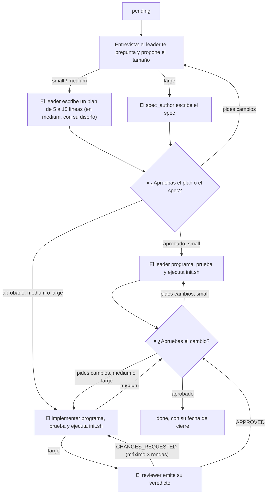

# Harness Engineering para Claude Code

Plantilla para que agentes de IA desarrollen software de forma **autónoma y
verificable** con [Claude Code](https://github.com/anthropics/claude-code).
Organiza el repositorio en torno a cinco ideas:

- **Agentes con papeles separados**: uno orquesta, planifica y hace él mismo
  los cambios pequeños; otro programa los medianos y los grandes; y, en los
  grandes, uno especifica y otro revisa.
- **El esfuerzo es proporcional al cambio**: cada feature tiene un tamaño
  (`small`, `medium` o `large`) y de él salen quién la implementa, el plan o
  el spec, los tests y la verificación. Siempre con tus dos aprobaciones. Un
  cambio trivial ni siquiera es una feature.
- **Memoria dentro del repositorio**, poca y al día, para que nada dependa de
  lo que recuerde el modelo.
- **Verificación automática**: un script y unos pocos hooks bloquean lo que
  no se puede saltar.
- **Menos es más**: el arnés guarda lo que el modelo no puede deducir (los
  hechos del proyecto, sus trampas y tus decisiones) y no le explica cómo
  programar.

Incluye un proyecto de ejemplo, un CLI de notas en Python, que sirve solo
como guía: enseña cómo queda cada archivo cuando está relleno.

> Lo importante de este repositorio no es **qué** hace la aplicación, sino
> **cómo** está organizado para que un agente trabaje en él sin perderse, sin
> saltarse pasos y sin gastar de más.

## Índice

1. [Qué es y qué problema resuelve](#qué-es-y-qué-problema-resuelve)
2. [Requisitos](#requisitos)
3. [Inicio rápido](#inicio-rápido)
4. [Cómo arranca una sesión](#cómo-arranca-una-sesión)
5. [Los agentes](#los-agentes)
6. [El ciclo de vida de una feature](#el-ciclo-de-vida-de-una-feature)
7. [La memoria del proyecto](#la-memoria-del-proyecto)
8. [Las convenciones del proyecto](#las-convenciones-del-proyecto)
9. [El árbitro: init.sh](#el-árbitro-initsh)
10. [Los hooks y los permisos](#los-hooks-y-los-permisos)
11. [El grafo de contexto](#el-grafo-de-contexto)
12. [El proyecto de ejemplo](#el-proyecto-de-ejemplo)
13. [Empezar tu propio proyecto](#empezar-tu-propio-proyecto)
14. [Estructura del repositorio](#estructura-del-repositorio)
15. [Principios de diseño](#principios-de-diseño)
16. [Créditos y licencia](#créditos-y-licencia)

## Qué es y qué problema resuelve

Un agente de IA que trabaja solo en un proyecto tiene cinco problemas:

- **Olvida.** Cada sesión, cada subagente y cada compactación del contexto
  empiezan de cero.
- **Supone.** Si una regla no está escrita, la inventa con lo que tenga a
  mano.
- **Se aprueba a sí mismo.** Dice «funciona» sin demostrarlo.
- **Lee de más.** Recorre archivos enteros para orientarse y gasta el
  contexto, que es lo que más le escasea.
- **Hace de más.** Si las reglas le piden el máximo, lo da aunque el cambio
  sea pequeño: specs largos, baterías de tests, entornos levantados.

La respuesta de este arnés es una sola idea: **el repositorio es el
sistema**. Lo importante vive en archivos versionados, y un script y unos
hooks comprueban que se cumple. El sistema tiene seis piezas:

| Pieza | Dónde está | Para qué sirve |
|---|---|---|
| Instrucciones | [`CLAUDE.md`](CLAUDE.md) → [`AGENTS.md`](AGENTS.md) y [`.claude/agents/`](.claude/agents/) | Las reglas comunes y lo que hace cada agente |
| Agentes | `leader`, `implementer` y, en los cambios grandes, `spec_author` y `reviewer` | Repartir el trabajo y que nadie apruebe lo suyo |
| Memoria | [`feature_list.json`](feature_list.json), [`progress/`](progress/), `specs/` y [`docs/lessons.md`](docs/lessons.md) | Que nada dependa de que alguien recuerde |
| Convenciones | [`docs/architecture.md`](docs/architecture.md), [`docs/conventions.md`](docs/conventions.md) y [`docs/verification.md`](docs/verification.md) | Dejar escrito qué es un buen trabajo y cuánto verificar |
| Verificación | [`init.sh`](init.sh), [`lint.sh`](lint.sh) y los hooks de [`.claude/settings.json`](.claude/settings.json) | Que saltarse una regla produzca un fallo, y que lo que se puede comprobar sin juicio no dependa de que alguien lo lea |
| Contexto (opcional) | `graphify-out/`, que se genera en local | Responder preguntas amplias sobre el código sin leerlo entero |

Vocabulario mínimo para leer el resto:

- **Claude Code**: el asistente de programación de Anthropic que se usa desde
  la terminal. Aquí ejecuta a todos los agentes.
- **Subagente**: un agente que la sesión principal lanza para una tarea
  concreta. Empieza con el contexto vacío y, al terminar, devuelve un
  resultado.
- **Feature**: una unidad de trabajo de la cola `feature_list.json`: un
  comando nuevo, una pantalla, una regla que cambia…
- **Tamaño (`size`)**: cuánto cambia una feature: `small`, `medium` o
  `large`. Decide el camino que sigue (ver
  [El ciclo de vida de una feature](#el-ciclo-de-vida-de-una-feature)). Un
  cambio **trivial** (un texto, un estilo, un renombre) no llega a feature.
- **Plan**: lo que el leader escribe antes de una feature `small` o `medium`,
  en 5 a 15 líneas: qué archivos cambian, qué tests se escriben y qué queda
  fuera. En una `medium` lleva debajo el **diseño**: lo que el leader ya
  averiguó y decidió, escrito para el implementer.
- **Spec**: la especificación de una feature `large`, en un solo archivo:
  objetivo, requisitos con su test, diseño y tareas.
- **Hook**: un comando que Claude Code ejecuta por su cuenta cuando pasa algo
  (antes de editar un archivo, al terminar un turno…) y que puede bloquear la
  acción.

### Por qué es más simple de lo que era

La primera versión de este arnés aplicaba el mismo proceso a todo: entrevista,
spec de tres archivos en notación EARS, implementación, revisión, mapa de
trazabilidad, tags, memoria de dos niveles con archivos de archivo, siete
hooks y verificación de extremo a extremo. En un proyecto real, un cambio de
unas 40 líneas (una regex y dos topes de longitud) costó así unos 510k tokens
y más de media hora de agentes: un diseño de 300 líneas, barridos de millones
de cadenas, 57 tests de una sola regex, una base de datos en Docker y un
navegador automatizado. Y lo más caro fue que los agentes cumplieron las
reglas al pie de la letra.

La lección: **las reglas ganan al juicio**. Cuantas más reglas, más trabajo
mecánico para cumplirlas. Por eso esta versión guarda solo lo que el modelo
no puede deducir y dimensiona el esfuerzo con el tamaño de la feature, que
propone el leader y confirmas tú.

Una medición posterior, en el mismo proyecto, comparó tres cambios hechos con
el arnés y con Claude Code sin él. El código salía equivalente, pero un cambio
`small` tardaba el doble con el arnés: el leader resolvía el problema para
escribir el plan y el implementer, que arranca sin ese contexto, lo volvía a
deducir; además, la verificación completa se ejecutaba tres veces. De ahí
salen tres reglas de esta versión: **quien diseña un cambio pequeño lo
implementa**, **el diseño viaja escrito** al implementer en los demás, y **la
verificación completa se ejecuta una vez por feature**. Repetida la misma
tarea con ellas, pasó de 14,6 a 10,5 minutos y de 7,0 a 5,3 dólares, con la
misma calidad; sin arnés eran 6,9 minutos y 3,9 dólares. Lo que queda de
diferencia es el plan que apruebas antes de que se toque el código.

## Requisitos

| Herramienta | ¿Hace falta? | Para qué |
|---|---|---|
| [Claude Code](https://github.com/anthropics/claude-code) | Sí | Ejecuta a los agentes |
| Python 3.9 o superior | Sí | Lo usan `init.sh` y los hooks, aunque tu proyecto sea de otro lenguaje |
| git | Recomendado | El historial de lo hecho es git, el reviewer revisa con `git diff` y sin git no se puede deshacer la retirada del ejemplo |
| [graphify](https://github.com/Graphify-Labs/graphify) | Opcional | El grafo de contexto. Se instala con `uv tool install graphifyy` (o `pip install graphifyy`) |
| `playwright-cli` o `chrome-devtools` | Solo si tu proyecto tiene interfaz web y un spec justifica abrirla | Que el reviewer pruebe la interfaz (ver [`docs/ui-review.md`](docs/ui-review.md) y sus skills en `.claude/skills/`) |

Sin graphify todo funciona igual: los agentes se orientan con grep y leyendo
solo lo necesario.

## Inicio rápido

```bash
git clone https://github.com/<usuario>/<repositorio>.git
cd <repositorio>
./init.sh   # tiene que terminar con «[OK] Entorno listo»
claude      # abre Claude Code; la sesión arranca como el agente leader
```

En un clon recién descargado, `./init.sh` termina con algo así:

```
── 5. Estado del trabajo ───────────────────────────────
  Features del proyecto: ninguna
  Ejemplos:              incluidos solo como guía (carpetas example/)
  Siguiente id libre:    F-12
  Verificación completa: en verde para el código actual (27 tests, 2026-11-20 12:19): no la repitas
  Fuera de las features: 0 decisión(es) pendiente(s) del usuario, 0 deuda(s) (progress/pending.md)
  Git:                   rama main, 0 archivo(s) con cambios sin commitear

── 6. Resumen ──────────────────────────────────────────
[OK]    Entorno listo. Puedes empezar a trabajar.
```

Después, en el chat de Claude Code:

1. **Cuéntale al leader qué quieres construir**, por ejemplo «quiero que los
   usuarios puedan registrarse con email y contraseña». Lo añade como
   feature a la cola.
2. **Pídele «implementa la siguiente feature pendiente».** La primera vez
   prepara contigo el proyecto (ver
   [Empezar tu propio proyecto](#empezar-tu-propio-proyecto)). Después te
   hace las preguntas que solo tú puedes responder y te propone un tamaño.
3. **Aprueba el plan o el spec.** En una feature `small` o `medium` te
   enseña un plan corto en el chat; en una `large`, un spec en
   `specs/<feature>/spec.md`. Responde «aprobado» o pide cambios.
4. **Aprueba el cambio.** El leader implementa la feature él mismo si es
   `small`, o lanza al implementer (y al reviewer, si es `large`), y vuelve a
   **parar** con un resumen: qué cambió y cómo se verificó. Responde
   «aprobado» para cerrar la feature, o pide cambios.

Un cambio trivial (un texto, un renombre) no pasa por la cola: el leader
confirma contigo que lo es, lo hace el implementer y tú lo apruebas.

## Cómo arranca una sesión

1. **La sesión principal es el leader.** `.claude/settings.json` contiene
   `"agent": "leader"`. No hablas con un Claude genérico, sino con un
   orquestador que solo toca el código en las features `small`, y solo con
   su plan aprobado.
2. **Se cargan las reglas comunes.** `CLAUDE.md` importa `AGENTS.md`: el mapa
   del repositorio y las reglas que valen para todos. Esto ocurre también en
   cada subagente.
3. **El leader recibe el estado real.** Un hook ejecuta `./init.sh --status`
   y le pasa el resultado: las features de tu proyecto, lo que espera tu
   aprobación (un plan, un spec o un cambio), la siguiente pendiente y el
   siguiente id libre.
4. **El leader lee lo justo.** Con tu primera petición lee
   `feature_list.json` y `progress/current.md`. `progress/pending.md` lo abre
   solo cuando hace falta.

> **La regla que atraviesa todo el sistema:** si `init.sh` contradice lo
> escrito en `progress/`, manda `init.sh`. Lo escrito a mano se queda
> desfasado; lo que se calcula a partir de los archivos, no.

## Los agentes

Cada agente tiene su definición en [`.claude/agents/`](.claude/agents/), de
entre 50 y unas 200 líneas. El leader usa el modelo de tu sesión; los tres
subagentes fijan el suyo en la cabecera de su definición (`model: opus`), que
es donde se cambia:

| Agente | Qué hace | Qué puede escribir | Qué devuelve |
|---|---|---|---|
| **leader** (sesión principal) | Te entrevista, propone el tamaño, escribe el plan de las features `small` y `medium`, implementa las `small`, lanza a los demás, para en las puertas de aprobación y cierra | `feature_list.json`, `progress/` y `docs/`. `src/` y `tests/`, solo en una feature `small` con su plan aprobado | Mensajes para ti |
| **implementer** | Hace lo que dicen el plan o el spec de una feature `medium` o `large`, con sus tests, y lo verifica. También los cambios triviales | `src/`, `tests/` y `progress/impl_<feature>.md` | `done -> progress/impl_<feature>.md` |
| **spec_author** | Solo en features `large`: convierte la feature y tu entrevista en un spec corto | `specs/<feature>/spec.md` | `spec_ready -> specs/<feature>/spec.md` |
| **reviewer** | En features `large`, o si lo pides: aprueba o rechaza el cambio contra el spec y los docs | Solo `progress/review_<feature>.md` | `APPROVED`, `CHANGES_REQUESTED` o `SCREENSHOT_REQUESTED`, con la ruta del informe |

Nadie aprueba lo suyo: el spec_author no escribe código, el implementer no
se aprueba a sí mismo y el reviewer no corrige. El leader programa solo las
features `small`: ahí quien planifica implementa, porque pasarle un cambio
pequeño a un agente que arranca de cero obliga a pensarlo dos veces. Por
encima de todos, **solo tú apruebas** un plan, un spec o un cambio, y solo
tú decides que algo es trivial.

### Cómo se coordinan

- **Cada subagente empieza sin contexto.** No hereda la conversación: el
  leader le copia en el prompt la entrada de la feature (`id`, `name`,
  `size`, `description`, `acceptance`…), su fuente (el plan o el spec) y, en
  una línea, la verificación que toca según el tamaño. Así cada uno trabaja
  con un contexto pequeño y limpio.
- **Lo ya razonado viaja escrito.** Empezar sin contexto tiene un precio: el
  subagente no sabe lo que el leader averiguó ni por qué eligió una solución,
  y lo volvería a deducir. Por eso el plan de una `medium` y el spec de una
  `large` llevan una sección «Diseño» (qué se leyó, la solución exacta, por
  qué y qué se descartó), y el implementer la aplica sin reabrirla. En una
  `small` no hace falta: la implementa el mismo leader.
- **Divulgación progresiva.** Cada definición dice qué leer, y nadie lee por
  adelantado. Los procedimientos que se usan una sola vez
  ([`docs/project-setup.md`](docs/project-setup.md) y
  [`docs/ui-review.md`](docs/ui-review.md)) solo se abren cuando hacen falta.
- **Regla anti-teléfono-descompuesto.** Los resultados se escriben en disco y
  por el chat solo viaja una línea con la ruta. La información no se degrada
  al pasar de un agente a otro, queda versionada y sobrevive a una
  interrupción.
- **A la primera.** El leader no relanza a un subagente para corregir algo
  que podía haber dicho en su prompt. El spec_author comprueba su propio spec
  con `./init.sh --status` antes de entregarlo.

### Qué lee cada uno

| Agente | Qué lee |
|---|---|
| implementer | `architecture.md`, `conventions.md` y `verification.md` (cortos), de `lessons.md` lo que toque su cambio, y el plan con su diseño o el spec |
| spec_author | `brief.md` y `architecture.md`, de `lessons.md` lo que toque su diseño, y las decisiones de tu entrevista |
| reviewer | Lo mismo que el implementer, más el spec, el informe del implementer y el diff |

### Cómo usan las skills

Ningún agente tiene la herramienta `Skill`, y es una decisión. Las skills del
proyecto se leen con `Read` desde su ruta cuando hacen falta: `grilling`, si
el leader quiere la técnica completa de la entrevista, y `playwright-cli` y
`chrome-devtools-cli` en una revisión de UI que el spec justifique
([`docs/ui-review.md`](docs/ui-review.md)). Si una skill choca con las reglas
del arnés, mandan las reglas.

- **Con la herramienta, cada agente vería también tus skills personales**
  (`~/.claude/skills/`) y podría invocarlas cuando su descripción le pareciera
  oportuna: revisiones, registros de decisiones o escrituras fuera del
  repositorio que compiten con el flujo. El arnés se comportaría distinto en
  cada máquina.
- **Con el mismo nombre, la skill personal gana a la del proyecto**, también
  al precargarla con `skills:`, que sale del mismo conjunto. Solo la lectura
  por ruta garantiza la versión del repositorio.
- **El proyecto no puede evitarlo de forma general.** `skillOverrides` oculta
  skills por su nombre, y la plantilla no sabe cuáles tendrá cada usuario.

Para añadir una skill, ponla en `.claude/skills/<nombre>/` (con `LICENSE` y
`SOURCE.txt` si es de terceros) y añade a la definición del agente que la use
una línea que diga cuándo la lee. Sin esa línea, ningún agente la usa.

### Dónde deja su rastro cada uno

| Archivo | Quién lo escribe | Qué contiene |
|---|---|---|
| `progress/current.md` | leader | La feature en curso: tamaño, estado, decisiones de la entrevista, plan aprobado y, en `medium`, su diseño |
| `specs/<feature>/spec.md` | spec_author | Solo en `large`: objetivo, requisitos con su test, diseño y tareas |
| `progress/impl_<feature>.md` | implementer | Cambios, tests, resultado de `init.sh` y notas para el leader, en 15 líneas como mucho. Una `small` no lo lleva |
| `progress/review_<feature>.md` | reviewer | Veredicto y hallazgos, en unas 30 líneas como mucho |
| `feature_list.json` | leader | La cola de features y las cerradas, con su tamaño y su fecha de cierre |

## El ciclo de vida de una feature

El tamaño decide el camino. El leader lo conduce y se detiene en las dos
puertas (⏸), donde decides tú:



| Tamaño | Qué cambia | Antes de implementar | Quién implementa | Verificación |
|---|---|---|---|---|
| `small` | Una regla, un tope, una validación, un mensaje o un campo de algo que ya existe | Un plan corto que apruebas | El leader, en la misma sesión | Un test por regla y su borde, y `./init.sh` |
| `medium` | Una pieza nueva o cambiada con lógica propia (un caso de uso, una consulta, un comando, un endpoint, una pantalla) | Un plan corto que apruebas, con su diseño | El implementer | Los tests de lo que cambia y `./init.sh` |
| `large` | Un flujo nuevo que cruza componentes, una migración o un refactor | Un spec que apruebas | El implementer, y lo revisa el reviewer | Lo mismo, con reviewer |

**Un cambio trivial no es una feature.** Un texto, un estilo o un renombre,
sin lógica, no entra en la cola ni lleva plan ni informe: el leader confirma
contigo que lo es, el implementer lo hace, el leader ejecuta `./init.sh` y tú
lo apruebas. El rastro es el commit. Meterlo en la cola costaba más en
anotaciones que el propio cambio.

En ningún tamaño se levanta por defecto la aplicación, una base de datos o un
navegador: solo si algo no se puede comprobar de otra forma y el plan o el
spec lo justifica. La tabla completa está en
[`docs/verification.md`](docs/verification.md).

| Estado | Qué significa |
|---|---|
| `pending` | En la cola. Si tiene su plan escrito, espera tu aprobación (`init.sh` lo dice). |
| `spec_ready` | Solo en `large`: el spec espera tu aprobación. No se toca código. |
| `in_progress` | Aprobada: se implementa (y se revisa, si es `large`), o el cambio espera tu aprobación final. |
| `done` | Aprobada por ti, con su fecha `closed`. |
| `blocked` | Atascada. El motivo está en `progress/current.md`. |

Solo puede haber una feature `in_progress` a la vez.

### 1. Entrevista y tamaño

Antes del plan o del spec, el leader te pregunta **solo lo que tienes que
decidir tú**: alcance, casos límite, mensajes, qué queda fuera.

- Numera las preguntas `P1`, `P2`… y da su recomendación en cada una, de modo
  que «sí» acepte lo que recomienda.
- Lo que se puede averiguar (qué hay en el código, qué usa qué) lo busca él.
- Por defecto recomienda lo mínimo que cumple el `acceptance`; lo futuro va a
  «Fuera de alcance» o a una deuda, no a la feature.
- Si una respuesta choca con lo que el proyecto no debe hacer
  (`docs/brief.md`) o con una lección aprendida, te avisa.
- Te propone el tamaño, con lo que implica («`small`: plan corto, un test por
  regla y su borde, sin levantar la app»). Ante la duda, el menor.
- Con tu confirmación, guarda las decisiones en `progress/current.md`.

Si la feature ya está bien definida, la entrevista se reduce a un mensaje que
confirmas. Y si lo que hay que decidir cabe junto al plan, las preguntas y el
plan llegan en el mismo mensaje, en una sola parada: en una `small` es lo
normal. La técnica completa, si se quiere, es la skill
[`grilling`](.claude/skills/grilling/SKILL.md).

### 2. Plan o spec

**Plan (`small` y `medium`).** El leader lee el código que necesita, sin
tocarlo, y escribe en `progress/current.md` de 5 a 15 líneas:

```markdown
## Plan — F-8
- Cambios: src/cli.py → cmd_count y su subparser `count`
- Tests: test_count_empty (sin notas: imprime 0), test_count_after_add (cuenta las notas guardadas)
- Interfaz pública: nuevo comando `count`
- Fuera de alcance: contar por fechas
```

Te lo enseña en el chat y espera tu «aprobado».

En una `medium`, debajo del plan escribe además el **diseño**, que es para el
implementer: qué leyó y qué importa de ahí (`archivo:línea`), la solución
exacta (firmas, nombres, tipos), por qué así, qué descartó y las trampas. No
tiene tope de líneas, pero solo lleva lo que el leader ya averiguó.

**Spec (`large`).** El spec_author escribe un solo archivo,
`specs/<feature>/spec.md`, de como mucho 150 líneas con texto (`init.sh` lo
comprueba): objetivo, requisitos (cada uno con el test que lo verifica),
diseño (qué se leyó, archivos, firmas y contratos con nombres exactos, por
qué así, una alternativa descartada y las trampas) y tareas. Un fragmento del spec de muestra
([`specs/example/cli_recent/spec.md`](specs/example/cli_recent/spec.md)):

```markdown
## Requisitos

- R1 — `recent` sin `--limit` imprime como máximo 5 notas, de la más reciente a la más antigua → test: `test_recent_default_limit_orders_by_created_at_desc`
- R4 — Con `--limit` ≤ 0, sale con código distinto de 0, escribe un mensaje en stderr y no toca el archivo de notas → tests: `test_recent_invalid_limit_zero`, `test_recent_invalid_limit_negative`
```

El spec_author no ejecuta nada para comprobar su diseño (eso lo hacen los
tests que planifica), escribe un requisito por comportamiento y, si algo
contradice el brief o una lección, para y explica por qué.

### 3. Primera puerta: apruebas el plan o el spec

El leader **para**. Lees el plan en el chat (o el spec en su archivo) y
respondes «aprobado» o pides cambios. Si los cambios alteran el alcance, hay
una pregunta corta sobre ellos y se rehace. Un cambio trivial no tiene esta
puerta: no es una feature.

### 4. Implementación

El leader pasa la feature a `in_progress`. Quién programa depende del tamaño:

- **`small`: el propio leader**, en la misma sesión. Lo que averiguó para
  escribir el plan ya está en su contexto, así que no hay subagente ni
  informe. El hook H1 solo le deja escribir en el código mientras la feature
  está `in_progress`, es decir, con el plan ya aprobado.
- **`medium` y `large`: el implementer**, que aplica el diseño ya decidido
  (el del plan o el del spec) sin volver a deducirlo.

Quien programa hace lo que dicen el plan o el spec, y nada más:

- escribe los tests que nombran (uno por regla y su borde) y ninguno más;
- mientras trabaja, solo ejecuta sus tests; al final, `./init.sh` una vez,
  que deja anotado qué código comprobó para que nadie tenga que repetirlo;
- si algo le obliga a salirse del plan, para: no improvisa diseño.

El informe del implementer cabe en unas líneas. El de muestra
([`progress/example/impl_cli_recent.md`](progress/example/impl_cli_recent.md)):

```markdown
- Cambios: `src/cli.py` → `cmd_recent` y el subparser `recent` con `--limit`; `tests/test_cli.py` → cinco tests y el helper `_add_with_created_at`
- Tests: `test_recent_default_limit_orders_by_created_at_desc`, `test_recent_custom_limit`, …
- Verificación: `./init.sh` en verde, 27 tests (5 nuevos)
- Notas: notas creadas seguidas comparten `created_at`; los tests de orden fijan la fecha
```

### 5. Revisión (solo en `large`, o si la pides)

El reviewer lee el diff real, no solo el informe, y comprueba que cada
requisito se cumple y tiene su test, que la verificación completa sigue en
verde para el código actual (se lo dice `./init.sh --status`; no la repite) y
que el cambio respeta la arquitectura y las convenciones. No exige más tests ni más
verificación de los que da el tamaño, y no abre la app ni el navegador salvo
que el spec lo justifique; para una captura de pantalla te pide permiso
(`SCREENSHOT_REQUESTED`).

Con `CHANGES_REQUESTED`, el implementer corrige y se revisa otra vez, como
máximo tres rondas. Si la tercera no termina en `APPROVED`, el leader para y
te explica por qué no se avanza y qué opciones hay.

### 6. Segunda puerta: apruebas el cambio

El leader **para** y te resume lo necesario para decidir sin abrir archivos:
qué cambió (`git diff --stat`), cómo se verificó (`init.sh`), los hallazgos
del reviewer si los hubo y lo que quedó fuera. Quien cierra la feature eres
tú.

### 7. Cierre

Cuando respondes «aprobado», el leader:

- apunta en `progress/pending.md` como deuda lo que sigue abierto;
- si la feature enseñó una trampa o un callejón sin salida, añade una entrada
  corta a `docs/lessons.md`;
- ejecuta `./init.sh --close <id>`, que la marca como `done` con su fecha de
  cierre (`closed`) y deja `progress/current.md` en su plantilla. No repite
  la verificación: se niega a cerrar si el código cambió desde la última en
  verde.

El commit lo haces tú, o el leader si se lo pides.

### Cómo decide el leader qué hacer

El leader no recuerda dónde se quedó: lo deduce del estado de las features,
de `progress/current.md` y de los informes en disco. Por eso una sesión
interrumpida se retoma sin perder nada.

| Situación | Qué hace el leader |
|---|---|
| `pending` sin plan | Comprueba que el proyecto está preparado, te entrevista y escribe el plan, o lanza al spec_author |
| `pending` con su plan escrito, o `spec_ready` | Espera tu aprobación |
| `in_progress` con su informe del implementer, o una `small` ya verificada | Espera tu aprobación final (o, si es `large`, lanza la revisión) |
| `in_progress` sin informe ni verificación | La sesión se cortó: te pregunta si sigue o lo deja |

## La memoria del proyecto

La memoria es lo que da contexto a los agentes: los documentos de `docs/`,
`progress/` y `specs/`, y la lista de features. El criterio es que sea
**poca y esté al día**: cada archivo que un agente lee por defecto se paga en
contexto en cada feature.

| Archivo | Qué guarda | Quién lo lee |
|---|---|---|
| `AGENTS.md` y la definición de cada agente | Las reglas comunes y lo que hace cada papel | Todos, siempre |
| [`feature_list.json`](feature_list.json) | La cola y las features cerradas, con su tamaño y su fecha de cierre | leader |
| [`progress/current.md`](progress/current.md) | La feature en curso: tamaño, estado, decisiones, plan y diseño | leader e implementer |
| [`progress/pending.md`](progress/pending.md) | Decisiones que esperan por ti (`Q<n>`) y deuda (`D<n>`) | leader, cuando hace falta |
| [`docs/brief.md`](docs/brief.md) | Para qué existe el proyecto y qué no debe hacer | leader y spec_author |
| `docs/architecture.md`, `docs/conventions.md` y `docs/verification.md` | Las reglas del proyecto | implementer, reviewer y spec_author |
| [`docs/lessons.md`](docs/lessons.md) | Trampas, callejones sin salida y decisiones que no se reabren, en una o dos líneas cada una | Todos, antes de «arreglar» algo raro |
| `specs/<feature>/spec.md` e informes | El spec de cada feature `large` y los informes de cada feature | implementer, reviewer y leader, mientras está abierta |
| [`docs/project-setup.md`](docs/project-setup.md), [`docs/ui-review.md`](docs/ui-review.md) y [`docs/graphify.md`](docs/graphify.md) | Guías de uso puntual | Solo cuando hacen falta |
| `docs/example/`, `specs/example/` y `progress/example/` | El proyecto de muestra | Solo en una feature de ejemplo |

El `README.md` no es memoria de los agentes: es para personas y ningún agente
lo lee.

**El historial de lo hecho es git.** No hay bitácora aparte, ni archivos de
archivo, ni tags, ni un buscador propio de la memoria: git guarda cada cambio
con su porqué, y grep encuentra cualquier id (`F-12`, `D7`, `ADR-3`) en todos
los archivos. Mantenerlo a mano era trabajo de cada cierre que casi nadie
leía.

### Reglas de la memoria

- **`current.md` sobrevive a la sesión, no a la feature.** Si cierras Claude
  Code a mitad de una feature, la siguiente sesión sigue por su «Estado».
  Solo se vacía al cerrar o abandonar la feature.
- **No se escribe lo que `init.sh` ya sabe** (tests en verde, features
  cerradas, cambios sin commitear), porque se desfasa en cuanto alguien
  trabaja fuera de la sesión. En los `.md` van las decisiones, los bloqueos y
  sus porqués.
- **Lo resuelto se borra.** Cuando decides una `Q<n>` o se resuelve una
  `D<n>`, su entrada sale de `pending.md`. Los ids nunca se reutilizan.
- **Una lección es corta y solo si enseña algo.** Una o dos líneas, y solo
  cuando la feature dejó una trampa, un callejón sin salida o una decisión
  que alguien podría reabrir sin saberlo.
- **Solo el leader escribe la memoria del proyecto.** Los demás aportan: el
  implementer, sus notas; el reviewer, sus hallazgos.
- **Lo que se puede comprobar no se apunta: se codifica.** Una regla que un
  chequeo puede comprobar sin juicio va a `lint.sh` o `init.sh`, no a una
  lección ni a un doc.

[`docs/example/lessons.md`](docs/example/lessons.md) tiene un ejemplo
relleno: ADR-02 explica por qué `--limit` lo valida el comando y no
`argparse`, y el callejón sin salida CS-01 avisa de no crear notas con `add`
en los tests que dependen del orden por fecha, porque se crean en el mismo
segundo.

> **No la confundas con la memoria de Claude Code.** Claude Code guarda
> además una memoria automática por usuario, fuera del repositorio. Esa no la
> ve quien clone el proyecto, así que no forma parte del arnés: lo que deba
> saber cualquier agente o persona va en los archivos de esta sección.

## Las convenciones del proyecto

Las reglas del proyecto son cinco archivos: `docs/brief.md`,
`docs/architecture.md`, `docs/conventions.md`, `docs/verification.md` y
`docs/lessons.md`.

| Archivo | Qué fija |
|---|---|
| [`docs/architecture.md`](docs/architecture.md) | Principios (los tres primeros son obligatorios: qué capa puede importar a cuál, dónde se valida lo que entra de fuera, y construir solo lo que pide el plan o el spec), stack, carpetas con una tabla de «dónde va cada cosa nueva», flujo de datos y qué no hacer |
| [`docs/conventions.md`](docs/conventions.md) | Estilo y formateador, nombres, estructura de cada archivo, tests (cuántos y cómo se nombran), errores y comentarios |
| [`docs/verification.md`](docs/verification.md) | Qué se verifica según el tamaño (igual en todos los proyectos), los niveles de test con sus comandos, el recorrido manual (excepcional), prácticas que no cuentan como verificación y trampas del entorno con el error literal |

La frase clave está en `architecture.md`: **«Si no está aquí, no es un
requisito»**. El reviewer solo puede rechazar lo que contradice algo escrito.
Y lo que esas reglas permiten comprobar sin juicio no se queda en texto: lo
comprueba [`lint.sh`](#el-análisis-estático-lintsh), y el doc solo dice
«(lo comprueba `lint.sh`)».

Estos archivos guardan **lo que el modelo no puede deducir**: las capas de tu
proyecto, sus comandos, sus trampas, sus decisiones. No le explican cómo se
programa ni cómo se escribe un test: eso ya lo sabe, y cada línea de más se
paga en cada feature.

Vienen como **plantillas con huecos** `<...>`, y su versión rellena para el
ejemplo está en [`docs/example/`](docs/example/). Un hueco es peligroso: el
agente que lo lea lo rellenará con lo que tenga más cerca. `init.sh` falla si
una feature de tu proyecto avanza con huecos en la arquitectura, las
convenciones o la verificación (en el brief solo avisa). Lo que no esté
decidido se escribe como «Sin decidir todavía» y se apunta como decisión
pendiente.

### Identificadores

Estos identificadores aparecen en todos los archivos:

| Id | Qué es | Dónde está |
|---|---|---|
| `F-<n>` | Feature, con el número de su campo `id` | `feature_list.json` |
| `P<n>` | Pregunta de la entrevista | El chat |
| `R<n>` | Requisito de un spec | `specs/<feature>/spec.md` |
| `T<n>` | Tarea de un spec | `specs/<feature>/spec.md` |
| `Q<n>` | Decisión que espera por ti | `progress/pending.md` |
| `D<n>` | Deuda o mejora | `progress/pending.md` |
| `ADR-<n>` | Decisión que no se reabre sin motivo | `docs/lessons.md` |
| `Bug-<n>` | Trampa: un bug difícil ya resuelto | `docs/lessons.md` |
| `CS-<n>` | Callejón sin salida | `docs/lessons.md` |
| `H1` | Hook de escritura protegida | [`AGENTS.md`](AGENTS.md) › Hooks |

## El árbitro: `init.sh`

[`init.sh`](init.sh) es la definición ejecutable de «está bien». Tiene
cuatro modos:

- **`./init.sh --status`** (unos segundos): las validaciones rápidas y el
  estado del trabajo. Lo ejecutan el hook de inicio de sesión, el spec_author
  para comprobar su spec y quien recibe el trabajo de otro.
- **`./init.sh --check`**: solo las validaciones rápidas, sin el estado. Lo
  ejecuta el hook de fin de turno, que solo necesita saber si algo está en
  rojo. Importa cuando calcular el estado es lento: en un proyecto real eran
  10 segundos al final de cada turno.
- **`./init.sh`** (completo): además, `lint.sh` y los tests. Lo ejecuta quien
  implementa, **una vez por feature**. En verde, anota la huella del código
  que comprobó (`.claude/state/verified.json`, sin versionar).
- **`./init.sh --close <id>`**: cierra la feature tras tu aprobación final,
  sin repetir la verificación ni enseñar el estado.

Nada se da por terminado sin `./init.sh` en verde, pero no hace falta
repetirlo para saberlo: `--status` compara aquella huella con el código
actual y dice si la verificación sigue valiendo. El leader, el reviewer y el
cierre miran esa línea, y solo se vuelve a ejecutar si el código cambió.

| Sección | Qué hace |
|---|---|
| 1. Entorno | Comprueba que hay Python 3.9 o superior |
| 2. Archivos base | Comprueba que existen `AGENTS.md`, `lint.sh`, `feature_list.json`, `progress/current.md`, `progress/pending.md` y los docs del proyecto |
| 3. La cola y los specs | Comprueba las reglas del flujo (abajo) |
| 4. Análisis estático y tests | Ejecuta `lint.sh` y la suite. En verde solo imprime una línea de cada uno, para no gastar contexto. No corre con `--status` |
| 5. Estado del trabajo | Las features de tu proyecto, lo que espera por ti, la siguiente pendiente, el siguiente id libre, si la última verificación completa sigue valiendo, decisiones y deuda abiertas, y git. Del ejemplo solo dice que está incluido como guía |
| 6. Resumen | `[OK]` o `[FAIL]` y el código de salida |

La sección 3 falla si:

- hay ids repetidos o más de una feature `in_progress`;
- una feature tiene un estado o un tamaño que no existe, o el tamaño
  `trivial` (un cambio trivial no es una feature);
- una feature en `spec_ready` o `in_progress` no tiene tamaño;
- una feature `done` no tiene su fecha `closed`;
- una feature `large` en `spec_ready` o `in_progress` no tiene su
  `spec.md`, o su spec pasa de 150 líneas con texto (también en `pending`,
  para que el spec_author lo vea antes de entregarlo);
- `progress/current.md` conserva una feature ya cerrada;
- una feature de tu proyecto salió de `pending` con huecos en los docs, o con
  `lint.sh` sin configurar.

`init.sh` no puede saber si aprobaste algo: eso lo garantiza el leader, que
solo ejecuta `--close` con tu «aprobado».

### El análisis estático: `lint.sh`

[`lint.sh`](lint.sh) comprueba las reglas del código que no piden juicio, y
lo ejecuta `init.sh` antes de los tests. Cada fallo dice dónde está, qué
hacer y qué doc fija la regla: el mensaje sustituye a la instrucción, así que
los docs solo dicen «(lo comprueba `lint.sh`)» y el reviewer no lo revisa
leyendo. Tiene dos bloques:

| Bloque | Qué comprueba | Quién lo escribe |
|---|---|---|
| Proyecto | El análisis estático de tu proyecto: el linter de tu stack (ruff, eslint, golangci-lint…) con las reglas de tus convenciones, y chequeos propios para lo que ninguna herramienta cubra, como la dirección de imports entre capas | El leader, contigo, al preparar el proyecto. Hasta entonces lleva la marca `SIN_CONFIGURAR`, que `init.sh` trata como un hueco de los docs |
| Ejemplo | Las reglas mecánicas de `docs/example/`: capas, solo biblioteca estándar, `print()` de debug, TODOs sin contexto, un test por módulo, sin mocks del filesystem y el estilo | Viene con la plantilla y se borra al retirar el ejemplo |

Es la pieza principal de una regla del arnés: **las lecciones se codifican**.
Cuando corriges lo mismo por segunda vez, el leader te propone convertirlo en
un chequeo de `lint.sh` o `init.sh` y borrar la instrucción que sustituye. Lo
que pide juicio queda en una línea, en el doc que corresponda (ver «Lo que se
corrige dos veces» en [`leader.md`](.claude/agents/leader.md)).

## Los hooks y los permisos

Un **hook** es un comando que Claude Code ejecuta por su cuenta cuando pasa
algo: antes o después de usar una herramienta, al empezar la sesión o al
terminar un turno. Recibe en JSON qué herramienta se usa, sobre qué archivo y
qué agente la usa. Si termina con el código 2, bloquea la acción y su mensaje
le llega al agente. Las instrucciones de los `.md` dicen qué hacer; los hooks
aseguran lo crítico aunque el modelo lo olvide.

Los de este repositorio están en
[`.claude/settings.json`](.claude/settings.json). Son tres:

| Hook | Cuándo salta | Qué hace | ¿Bloquea? |
|---|---|---|---|
| H1 Escritura protegida | Antes de `Edit` o `Write` | En `src/` y `tests/` solo escriben el implementer y, mientras hay una feature `small` en `in_progress`, el leader | Sí |
| Estado al iniciar | Al iniciar, reanudar, limpiar o compactar la sesión | Le pasa al leader el resultado de `init.sh --status` | No |
| Validación al terminar | Al final de cada turno del leader | Ejecuta `init.sh --check`; si falla, el leader no puede terminar | Sí, una vez |

Los mensajes que empiezan por `[harness]` vienen de estos hooks.

**Lo que se quitó, y por qué.** La primera versión tenía siete hooks: además
de estos, compilaba y probaba tras cada edición (decenas de segundos por
edición, y bloqueaba cambios de varias partes a mitad de camino), contaba las
rondas de revisión, recordaba consultar el grafo antes de cada lectura y
ejecutaba `init.sh` completo al final de cada turno, también en los de pura
conversación. Cada uno resolvía un problema real, pero juntos costaban más de
lo que evitaban.

**Permisos.** En el mismo archivo, `allow` lista lo que se ejecuta sin
preguntar (`./init.sh`, los tests, graphify y las herramientas de navegador)
y `ask`, lo que necesita tu confirmación (capturas de pantalla, PDF, vídeo y
trazas).

**Límites que conviene conocer:**

- H1 solo vigila `Edit` y `Write`. Escribir en `src/` con Bash no lo activa:
  está prohibido por las reglas, pero ningún hook lo impide.
- La validación al terminar deja terminar al segundo intento aunque siga en
  rojo, y te muestra un aviso.
- Si cambias los hooks de `.claude/settings.json`, comprueba que la sesión
  abierta los recoge; si no, se aplican al abrir la siguiente.
- Los permisos no son hooks: dependen del modo de permisos con que arranques
  Claude Code. Si usas un modo que omite las confirmaciones, comprueba que
  las de `ask` te siguen apareciendo. Si no, lo único que impide una captura
  es la regla escrita en la definición del reviewer.

## El grafo de contexto

[graphify](https://github.com/Graphify-Labs/graphify) analiza el repositorio
en local, sin modelos ni claves de API, y genera `graphify-out/graph.json`:

- cada función, clase, test y sección de un `.md` es un nodo;
- cada relación entre ellos (llama a, contiene, menciona) es una conexión,
  marcada como extraída del código o inferida con un grado de confianza.

Es **opcional**: sirve para preguntas amplias (qué usa qué, qué se rompe al
cambiar algo, cómo está organizado el proyecto). Para un símbolo o un texto
concreto, grep es más rápido. `init.sh` no lo reconstruye: se actualiza con
`graphify update .` antes de usarlo (tarda alrededor de un segundo), y el
wiki con `graphify export wiki`. `graphify-out/` no se versiona, y `.claude/`
no se indexa ([`.graphifyignore`](.graphifyignore)): el grafo describe el
proyecto, no el arnés.

Una consulta sobre el proyecto de ejemplo (salida recortada):

```
$ graphify explain "cmd_recent"
  Source:    src/cli.py L59
  --> load() [calls] [EXTRACTED] src/cli.py:L62
  --> NoteError [calls] [EXTRACTED] src/cli.py:L61
  <-- build_parser() [indirect_call] [INFERRED 0.85] src/cli.py:L122
  <-- Diseño [references] [INFERRED 0.95] specs/example/cli_recent/spec.md:L19
  <-- ADR-02 · `--limit` lo valida el comando [references] [INFERRED 0.95] docs/example/lessons.md:L25
```

Con una sola consulta sabes en qué línea está el código, a quién llama, quién
lo llama y qué spec y qué lección lo mencionan. Con eso se lee `src/cli.py`
desde la línea 59, no el archivo entero.

| Si necesitas | Comando |
|---|---|
| Dónde está algo y con qué se relaciona | `graphify explain "<símbolo>"` |
| Qué hay sobre un tema | `graphify query "<palabras>"` |
| Qué se rompe si cambias algo | `graphify affected "<símbolo>"` |
| Cómo se conectan dos piezas | `graphify path "<A>" "<B>"` |
| Las piezas centrales | `graphify god-nodes` |

El grafo no da parámetros, tipos ni el cuerpo de las funciones: para eso se
leen las líneas que indica. La búsqueda es literal, así que hay que preguntar
con los nombres del código (`save`, `NoteError`), no con descripciones. Más
detalles en [`docs/graphify.md`](docs/graphify.md).

## El proyecto de ejemplo

El repositorio trae un CLI de notas en Python que **sirve solo como guía**:
enseña cómo queda cada archivo del arnés cuando está relleno y cómo son los
informes de cada agente. Su código es deliberadamente simple.

Todo lo suyo está separado de tu proyecto:

| Dónde | Qué contiene |
|---|---|
| [`docs/example/`](docs/example/) | Los docs del proyecto, rellenos para el CLI de notas |
| [`specs/example/`](specs/example/) | `cli_recent/spec.md`, un spec de muestra ya implementado |
| [`progress/example/`](progress/example/) | Sus pendientes, informes de muestra del implementer y del reviewer, y notas de exploración |
| `src/` y `tests/` | El código del CLI (`storage.py`, `notes.py` y `cli.py`) y sus tests |
| `lint.sh`, bloque «Ejemplo» | Las reglas mecánicas de sus docs, comprobadas con la biblioteca estándar |
| `feature_list.json` | Sus features, marcadas con `"example": true` |

Cada plantilla de `docs/` tiene su gemelo relleno:

| Plantilla | Ejemplo relleno | Qué rellenas |
|---|---|---|
| `docs/brief.md` | `docs/example/brief.md` | Visión, usuarios, qué sí hace y qué no (te lo pregunta el leader) |
| `docs/architecture.md` | `docs/example/architecture.md` | Principios, stack y dependencias, estructura de carpetas, flujo de datos y qué no hacer |
| `docs/conventions.md` | `docs/example/conventions.md` | Estilo, nombres, estructura de archivo, tests y errores |
| `docs/verification.md` | `docs/example/verification.md` | Niveles de test, recorrido manual, anti-patrones y trampas del entorno (la tabla de tamaños no se rellena) |
| `docs/lessons.md` | `docs/example/lessons.md` | Trampas, callejones sin salida y decisiones (lo escribe el leader) |

Los agentes nunca mezclan las dos reglas: en una feature de ejemplo solo leen
lo de `example/`, y en una tuya, solo lo de fuera. Si aún no tienes ninguna
feature propia y le pides al leader «implementa la siguiente feature
pendiente», usará una de ejemplo para enseñarte el flujo, y todo lo que
genere quedará en las carpetas `example/`.

Para usar el CLI:

```bash
python3 -m src.cli add "comprar pan" --body "y leche"
python3 -m src.cli list
```

## Empezar tu propio proyecto

### Preparación (una sola vez)

Antes de tu primera feature, el leader prepara el proyecto contigo, según
[`docs/project-setup.md`](docs/project-setup.md):

1. **Brief.** Te pregunta qué es el proyecto, para quién es, qué no debe
   hacer todavía y cómo sabrás que funciona. Esto no lo saca del código.
2. **Arquitectura, convenciones y verificación.** Si ya tienes código, los
   redacta a partir de él, describiendo lo que hay, y tú los corriges. Si
   empiezas de cero, te pregunta y escribe solo lo que esté decidido.
3. **Comandos de tu stack.** Si no usas Python, hay que cambiar el comando de
   tests en `init.sh` (sección 4) y los permisos de `.claude/settings.json`;
   si tu código no está en `src/` y `tests/`, también las carpetas que vigila
   H1. Además acordáis el análisis estático (tu linter y lo que deba
   comprobarse sin juicio) y el leader lo escribe en el bloque «Proyecto» de
   `lint.sh`.
4. **Retirar el ejemplo**, cuando toque (abajo).

### Retirar el ejemplo

El ejemplo se retira entero, de una vez y solo con tu confirmación. El leader
te enseña la lista exacta de lo que se borra: sus features, su código y sus
tests, `specs/example/`, `progress/example/`, los archivos de
`docs/example/` cuya plantilla ya esté rellena y el bloque «Ejemplo» de
`lint.sh`. El implementer borra lo de `src/` y `tests/`; el leader, el
resto.

| Tu proyecto | Cuándo se retira |
|---|---|
| Ya tiene código o no usa Python | Al preparar el proyecto, antes de tu primera feature: el ejemplo no puede convivir con tu código |
| Empieza de cero y usa Python | Al cerrar tu primera feature: hasta entonces sirve de referencia |

Te quedan a mano este `README.md` y los campos `project` y `description` de
`feature_list.json`. Trabaja con el proyecto en git: es lo que permite
deshacer la retirada si algo sale mal.

### Tu primera feature, paso a paso

| # | Momento | Qué pasa | Qué piezas intervienen |
|---|---|---|---|
| 1 | Abres `claude` | La sesión es el leader y recibe el estado real | `settings.json`, `CLAUDE.md` y `AGENTS.md`, hook de inicio |
| 2 | Le describes tu feature | La añade a la cola con el siguiente id libre y estado `pending` | `feature_list.json` |
| 3 | «Implementa la siguiente feature pendiente» | Por ser la primera, antes prepara el proyecto | `docs/project-setup.md`, `pending.md` |
| 4 | Entrevista | Preguntas con su recomendación y el tamaño; tú confirmas | `current.md` |
| 5 | Plan o spec | El leader escribe el plan (`small`, `medium`) o el spec_author el spec (`large`) | `current.md` o `specs/<feature>/spec.md` |
| 6 | ⏸ Primera puerta | Apruebas el plan o el spec | — |
| 7 | Implementación | Lo que dice el plan, con sus tests; al final, `init.sh` | leader (`small`) o implementer, H1, `lint.sh` |
| 8 | Revisión (solo `large`) | Contra el spec y los docs, en tres rondas como máximo | reviewer |
| 9 | ⏸ Segunda puerta | El leader te resume el cambio y tú lo apruebas | — |
| 10 | Cierre | Deuda y, si la hay, una lección; `init.sh --close` pone la fecha de cierre | `pending.md`, `lessons.md`, `feature_list.json` |
| — | Al final de cada turno | `init.sh --check` | hook de fin de turno |

### Tu papel

Decides en la entrevista (también el tamaño), apruebas el plan o el spec,
apruebas el cambio, autorizas las capturas de pantalla, decides qué es
trivial y respondes las decisiones pendientes (`Q<n>`). Todo lo demás lo
conduce el leader.

## Estructura del repositorio

```
.
├── AGENTS.md              # Mapa y reglas comunes (lo cargan todos los agentes)
├── CLAUDE.md              # Se carga en cada sesión e importa AGENTS.md
├── feature_list.json      # La cola y las features cerradas, con su tamaño
├── init.sh                # Verificación: completa, rápida (--status, --check) y cierre (--close)
├── lint.sh                # Análisis estático del código (lo ejecuta init.sh)
├── specs/<feature>/       # spec.md de cada feature large
├── progress/
│   ├── current.md         # Feature en curso: decisiones, plan, diseño y estado
│   └── pending.md         # Decisiones pendientes y deuda
├── docs/
│   ├── brief.md           # Para qué existe el proyecto y qué no hace
│   ├── architecture.md    # Qué es un buen trabajo
│   ├── conventions.md     # Estilo, nombres y errores
│   ├── verification.md    # Qué verificar según el tamaño
│   ├── lessons.md         # Trampas, callejones sin salida y decisiones
│   ├── graphify.md        # Cómo consultar el grafo (opcional)
│   ├── project-setup.md   # Preparar el proyecto y retirar el ejemplo
│   └── ui-review.md       # Cómo revisar una interfaz web (excepcional)
├── .claude/
│   ├── settings.json      # Agente principal, hooks y permisos
│   ├── agents/            # leader, implementer, spec_author, reviewer
│   ├── boundary-discipline/ # Original del principio de fronteras (no es una skill)
│   ├── encode-lessons/    # Original del principio de codificar lecciones (no es una skill)
│   ├── skills/            # grilling, grill-me, playwright-cli, chrome-devtools-cli
│   └── yagni/             # Originales del principio YAGNI (no son skills)
├── src/                   # Código de la aplicación (al principio, el del ejemplo)
├── tests/                 # Tests automáticos (al principio, los del ejemplo)
├── docs/example/          # Docs rellenos del ejemplo
├── specs/example/         # Spec de muestra del ejemplo
├── progress/example/      # Pendientes e informes de muestra del ejemplo
└── graphify-out/          # Grafo de graphify, si lo usas (no se versiona)
```

## Principios de diseño

- **El repositorio es el sistema**: lo que no está en un archivo no existe
  para el siguiente agente.
- **Menos es más**: el arnés guarda lo que el modelo no puede deducir (hechos
  del proyecto, trampas, decisiones) y nada de metodología general. Cada línea
  que un agente lee por defecto se paga en cada feature.
- **El esfuerzo es proporcional al cambio**: el tamaño decide si hay plan o
  spec, cuántos tests y cuánta verificación; ante la duda, el menor.
- **El estado se calcula, no se recuerda**: `init.sh` manda sobre lo escrito,
  y el historial es git.
- **Separación de poderes**: quien escribe algo no lo aprueba, y la última
  palabra es tuya.
- **Lo razonado no se paga dos veces**: quien diseña un cambio pequeño lo
  implementa; en los demás, el diseño viaja escrito a quien programa; y la
  verificación completa se ejecuta una vez.
- **Primero el plan y luego el código**: tus decisiones quedan escritas antes
  de programar nada.
- **Cada requisito con su test**, y ningún test que nadie pidió.
- **Las lecciones se codifican**: lo que se puede comprobar sin juicio lo
  comprueba un mecanismo (`init.sh`, `lint.sh` o un hook), no una
  instrucción. El texto queda para lo que pide juicio.

## Créditos y licencia

- Plantilla derivada de
  [betta-tech/ejemplo-harness-subagentes](https://github.com/betta-tech/ejemplo-harness-subagentes)
  y, para el flujo con spec, de
  [betta-tech/harness-sdd](https://github.com/betta-tech/harness-sdd).
- Las skills `grilling` y `grill-me` vienen de
  [mattpocock/skills](https://github.com/mattpocock/skills) (MIT, Matt
  Pocock).
- La skill `chrome-devtools-cli` viene de
  [ChromeDevTools/chrome-devtools-mcp](https://github.com/ChromeDevTools/chrome-devtools-mcp)
  (Apache 2.0, Google LLC).
- La skill `playwright-cli` viene del paquete npm `@playwright/cli` de
  [microsoft/playwright-cli](https://github.com/microsoft/playwright-cli)
  (Apache 2.0, Microsoft Corporation).
- El principio «Fronteras y validación» de `docs/architecture.md` se basa en
  la skill `principle-boundary-discipline` de
  [pstack](https://github.com/cursor/plugins/tree/main/pstack) (MIT, Lauren
  Tan). El original está en `.claude/boundary-discipline/`.
- La sección «Lo que se corrige dos veces» de `.claude/agents/leader.md` se
  basa en la skill `principle-encode-lessons-in-structure` de pstack (MIT,
  Lauren Tan). El original está en `.claude/encode-lessons/`.
- El principio «Solo lo que pide el plan o el spec» de `docs/architecture.md`
  se basa en las skills `principle-subtract-before-you-add` y
  `principle-laziness-protocol` de pstack (MIT, Lauren Tan). Los originales
  están en `.claude/yagni/`.
- Versiones anteriores incluían la guía de revisión `code-reviewer.md` de
  [obra/superpowers](https://github.com/obra/superpowers) (MIT, Jesse
  Vincent); se retiró al simplificar el reviewer.

Las carpetas de estos componentes incluyen su licencia y un `SOURCE.txt` con
su origen. El resto del repositorio se distribuye bajo la licencia
[MIT](LICENSE), con copyright de erx-e.
